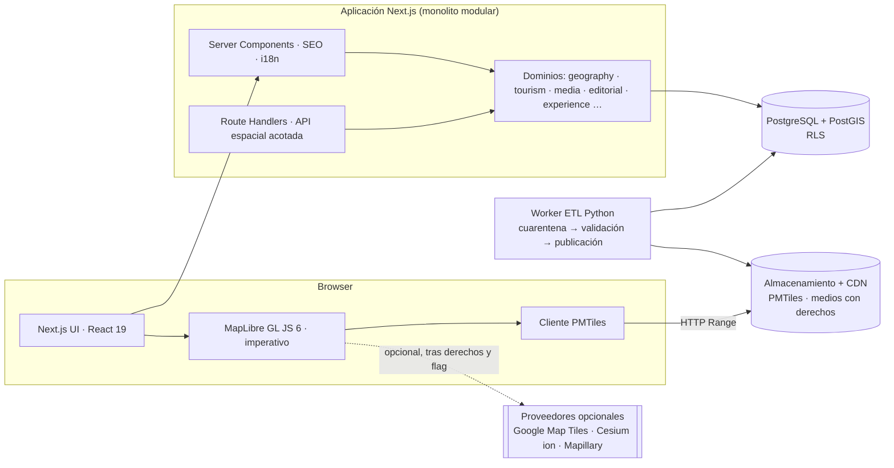
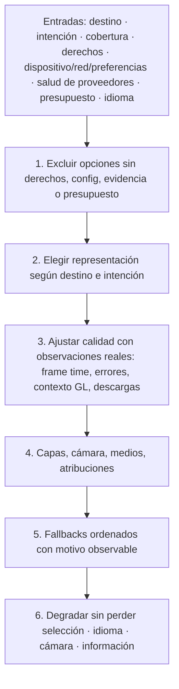

# Architecture v1 — Panamá Immersive

Estado: **v1 de Discovery**, 2026-10-20. Documento rector: `docs/PROMPT-MAESTRO.md` (copia literal, sin modificar). Referencias `E-nn` → `docs/research/evidence-log.md`. Decisiones con su historial → `docs/decisions/`.

Convención: **[Hecho]** comprobado y con evidencia · **[Supuesto]** hipótesis de trabajo · **[Pendiente]** decisión o dato que falta.

---

## A. Architecture Review del plan de partida

Revisión crítica del propio documento rector, como pidió el encargo: no se asume que su propuesta inicial sea correcta.

### Correcto y se mantiene

- Monolito modular primero; ETL pesado fuera del request web.
- Contratos **por capacidad** (imagery, terrain, 3D tiles, street, media, institucional, routing) y no un `VisualProvider` universal.
- Separar **representación** (qué se dibuja) de **calidad** (cuánto se dibuja): un equipo potente no crea fotogrametría.
- Estados de cobertura `UNKNOWN/VERIFIED/PARTIAL/UNAVAILABLE/ERROR`, donde `UNKNOWN` y `ERROR` no equivalen a ausencia.
- Procedencia por dato, derechos por activo, verificación derivada de evidencia con caducidad (nunca un booleano).
- Una funcionalidad con fixtures o deshabilitada no está terminada.

### Incorrecto o inconsistente (corregido en esta arquitectura)

| #   | Problema                                                                                                                                                                             | Evidencia  | Decisión                                                                                                                                                       |
| --- | ------------------------------------------------------------------------------------------------------------------------------------------------------------------------------------ | ---------- | -------------------------------------------------------------------------------------------------------------------------------------------------------------- |
| A1  | **Dos motores pesados (Cesium + MapLibre) en el camino crítico** duplican mantenimiento, bundle y memoria móvil, y la prioridad móvil lo desaconseja.                                | E-06       | MapLibre es el motor del MVP (2D, relieve 3D, offline). Cesium queda tras un adaptador y un flag hasta tener cobertura 3D verificada y credenciales. ADR-0004. |
| A2  | Se propone **MVT en PMTiles** y a la vez **Cesium**. En Cesium 1.146 el soporte MVT es `MVTDataProvider`, `@experimental`, que solo acepta plantillas `{z}/{x}/{y}`; no lee PMTiles. | E-06       | Para Cesium se necesitaría un puente XYZ propio. Es un coste que solo se paga si se activa Cesium. ADR-0005.                                                   |
| A3  | Se pide a la vez **slugs localizados por tabla** y **next-intl**: sus `pathnames` son estáticos.                                                                                     | E-11       | `pathnames` solo para rutas estructurales; los slugs de destino viven en un registro propio con redirecciones. ADR-0003.                                       |
| A4  | El `Link` hreflang automático de next-intl asume que todas las variantes existen; contradice «no indexes traducciones pendientes».                                                   | E-11       | `alternateLinks: false`; hreflang, canonical y sitemap se generan desde las variantes **realmente publicadas**.                                                |
| A5  | El presupuesto «6 MB para 3D» es **incompatible** con cargar Cesium completo (el motor desempaquetado pesa 27 MB; el bundle real no está medido).                                    | E-06       | Medir en Fase 2 antes de prometer. El MVP trabaja con el presupuesto «ligero».                                                                                 |
| A6  | «`TypeScript` estricto» no basta: la última versión estable (7.0.2) rompe el lint tipado.                                                                                            | E-04, E-05 | TypeScript **6.0.3** fijado; revisión periódica. ADR-0002.                                                                                                     |

### Riesgoso

| Riesgo                                            | Por qué                                                                                                                                                                                                                         | Mitigación                                                                                                                                     |
| ------------------------------------------------- | ------------------------------------------------------------------------------------------------------------------------------------------------------------------------------------------------------------------------------- | ---------------------------------------------------------------------------------------------------------------------------------------------- |
| **Homonimia geográfica**                          | El distrito _Barú_ **no** es el _Volcán Barú_; la localidad _Santa Catalina_ (Veraguas) **no** es el distrito _Santa Catalina o Calovébora_ (Comarca Ngäbe-Buglé). Emparejar por nombre produce geometrías falsas. [E-22, E-23] | Todo se relaciona por **ID estable**; nunca por nombre. Las geometrías se asignan a destinos mediante `destination_areas` con rol y evidencia. |
| **Geometría «oficial» que no lo es**              | Casco Antiguo solo aparece como `landuse=retail` en OSM; los parques nacionales son polígonos OSM, no de MiAmbiente. [E-23]                                                                                                     | Etiqueta obligatoria de procedencia: `official` / `osm_derived` / `editorial`. Nunca se presenta lo segundo como lo primero.                   |
| **Licencias de datos derivados**                  | Overture/OSM son ODbL (copyleft de base de datos) salvo Places. [E-33]                                                                                                                                                          | `docs/provider-rights.md`; atribución en el mapa y página de fuentes; los derivados publicados llevan su licencia. Revisión legal pendiente.   |
| **Datos personales en Overture Places**           | Trae teléfonos, emails y redes. [E-24]                                                                                                                                                                                          | No se importan campos de contacto sin base legal y revisión. Phase 6.                                                                          |
| **Terreno AWS**                                   | Vintage 2017; **a z12 en mar abierto devuelve 0 m**. [E-25]                                                                                                                                                                     | No se usa para zonas marinas; relieve solo sobre tierra; se declara la fuente y fecha.                                                         |
| **Fuentes oficiales no accesibles**               | IGN/ANATI, MiAmbiente, ATP, UNESCO no pudieron leerse; licencia de reutilización desconocida. [E-00, E-34]                                                                                                                      | Estado `UNKNOWN` explícito; bloqueo documentado; trabajo independiente continúa con datos abiertos verificados.                                |
| **Traducción automática de información sensible** | Seguridad, restricciones, información legal.                                                                                                                                                                                    | Política de publicación: estas categorías **exigen** revisión humana.                                                                          |
| **CSP vs render estático**                        | Nonce ⇒ render dinámico; sin nonce ⇒ `unsafe-inline`; SRI es experimental. [E-12]                                                                                                                                               | Se evalúa empíricamente en Fase 1 (ADR-0010).                                                                                                  |
| **Coste de Google 3D**                            | Facturación por solicitud de tile raíz, SKU Enterprise, precio no confirmado. [E-32]                                                                                                                                            | Deshabilitado por defecto; cuota/circuit-breaker antes de activar.                                                                             |

### Excesivo para el MVP (se difiere)

Sentry/OpenTelemetry completos hasta conocer el destino de despliegue; nivel `ULTRA`; WebGPU; búsqueda semántica (pgvector) sin necesidad probada; la lista completa de ~60 tablas (se crean por fase, con migraciones); plataforma de plugins; cualquier abstracción «universal» de visor.

### Faltante en el plan de partida (se añade)

- **Definición de «destino»** frente a «área geográfica», «lugar» y «punto de acceso» (ver §F y `docs/data-model.md`).
- **Flujo y coste editoriales**: revisión humana en 5 idiomas es el principal coste operativo, no la infraestructura (ver §S).
- **Páginas legales y privacidad** (cookie de idioma, geolocalización, analítica). [Supuesto] Marco panameño de protección de datos (Ley 81 de 2019): **pendiente de revisión legal**.
- **Política de obsolescencia** de datos (caducidad de verificación y de cobertura).
- **Moderación** de reclamaciones de fichas empresariales.
- **Alternativa textual del mapa** como requisito de primer nivel (lista de destinos/entidades sincronizada con la vista).
- **Copia de seguridad y rollback de migraciones**.

### Recomendado

Modular monolith · MapLibre primero · PMTiles estático en CDN · Postgres/PostGIS con RLS probado · next-intl con `proxy.ts` y registro propio de slugs · pipeline ETL en Python (pyarrow/GDAL/tippecanoe) fuera del request · adaptadores por capacidad con deny-by-default de derechos · calidad medida, no declarada.

---

## B. Technology Decision Matrix

Distinción necesaria: **CesiumJS** (biblioteca, Apache-2.0) ≠ **Cesium ion** (servicio de pago/cuota). **Google Maps JavaScript API** ≠ **Google Photorealistic 3D Tiles** (datos 3D vía Map Tiles API, con sus propias políticas).

| Herramienta             | Resuelve                                              | Realismo                   | Móvil     | GIS/MVT                            | 3D                  | Licencia                                  | Dependencia proveedor           | Veredicto                                                                                    |
| ----------------------- | ----------------------------------------------------- | -------------------------- | --------- | ---------------------------------- | ------------------- | ----------------------------------------- | ------------------------------- | -------------------------------------------------------------------------------------------- |
| **MapLibre GL JS 6.15** | Mapa vectorial 2D/relieve 3D ligero, PMTiles, offline | Medio (según estilo/datos) | **Bueno** | **Nativo** (MVT, raster-dem)       | Terreno + extrusión | BSD-3                                     | **Ninguna**                     | **Motor principal**                                                                          |
| **CesiumJS 1.146**      | Globo 3D real, 3D Tiles, terreno global               | Alto (con datos)           | Pesado    | MVT solo experimental, sin PMTiles | **Completo**        | Apache-2.0 (biblioteca)                   | Ion/Google si se usan sus datos | **Adaptador diferido** (ADR-0004)                                                            |
| Mapbox GL JS            | Vectorial 2D/3D                                       | Alto                       | Bueno     | Nativo                             | Terreno             | **Licencia propia + token + facturación** | **Alta**                        | Descartado: dependencia y coste innecesarios, MapLibre cubre el caso                         |
| Google Maps JS API      | Mapa de consumo, Street View                          | Alto                       | Bueno     | Limitado                           | Limitado            | Términos Google                           | **Total**                       | Descartado como base; el proyecto debe sobrevivir sin Google                                 |
| deck.gl 9.4             | Capas de datos masivas sobre un mapa                  | n/a                        | Medio     | Sí (como capa)                     | Capas 3D            | MIT                                       | Ninguna                         | **Diferido**: solo si MapLibre no alcanza en volumen de datos                                |
| three.js                | Gráficos 3D a medida                                  | Alto (trabajo propio)      | Medio     | **No**                             | Sí                  | MIT                                       | Ninguna                         | Descartado: no es un motor geoespacial; reinventaría la cartografía                          |
| Resium (React+Cesium)   | Wrapper declarativo                                   | —                          | —         | —                                  | —                   | MIT                                       | —                               | Descartado: el ciclo de vida imperativo del visor se controla mejor con un adaptador pequeño |

Otras decisiones de la matriz:

| Necesidad       | Elegido                                                      | Alternativas descartadas     | Motivo                                                                             |
| --------------- | ------------------------------------------------------------ | ---------------------------- | ---------------------------------------------------------------------------------- |
| Framework       | **Next.js 16.4.2** App Router, React 19.3.1                  | Remix, SPA pura              | SSR para SEO multilingüe, `proxy.ts`, ecosistema                                   |
| Idioma          | **TypeScript 6.0.3** estricto                                | TS 7.0.2                     | E-04/E-05                                                                          |
| i18n            | **next-intl 4.14.9**                                         | Rutas i18n propias           | Integración con App Router y `proxy.ts` (E-10); se acota su límite en slugs (E-11) |
| Estilos         | **CSS Modules + tokens CSS** con propiedades lógicas         | Tailwind, CSS-in-JS          | Control de identidad, propiedades lógicas, sin dependencia de runtime              |
| Estado UI       | **Zustand 5** (solo Fase 2+)                                 | Redux, Context               | Pequeño; la cámara **no** entra en el store                                        |
| Estado remoto   | **TanStack Query 5** (cuando haya API propia)                | SWR                          | Cancelación e invalidación                                                         |
| Validación      | **zod 4**                                                    | io-ts, manual                | Entorno, API y contenido                                                           |
| Datos           | **PostgreSQL 16 + PostGIS 3.4** (+ pgvector si se demuestra) | MongoDB, SQLite/SpatiaLite   | Geometría, RLS, SQL                                                                |
| Gestión BD      | SQL puro portable a Supabase                                 | Dependencia dura de Supabase | Ver ADR-0006                                                                       |
| Tiles estáticos | **PMTiles + tippecanoe**                                     | Martin/Tegola (servidor)     | Cero servidor, CDN. Martin se reevalúa para capas dinámicas                        |
| ETL             | **Python** (pyarrow, shapely, GDAL, tippecanoe)              | Node puro                    | Estado de la herramienta para GIS; separado de la app (ADR-0009)                   |
| Pruebas         | **Vitest 5**, **Playwright 1.64**, **axe-core**              | Jest, Cypress                | Velocidad, Chromium preinstalado                                                   |

---

## C. Arquitectura final



Flujo de datos de una vista: la URL (idioma, destino, cámara, capas) → RSC resuelve destino por ID estable y contenido en el idioma → el cliente crea **una** instancia del visor y consume PMTiles por Range → el _Experience Resolver_ decide representación/calidad/atribución → cualquier degradación conserva selección, idioma y cámara.

**Fuera de alcance deliberado**: microservicios, Kafka, Kubernetes, varios servidores de tiles, SDK público.

---

## D. Frontend

- **Estructura**: `src/app/[locale]/…` (rutas), `src/domains/<dominio>/` (modelo y lógica pura), `src/components/` (UI accesible), `src/i18n/`, `src/config/`, `src/styles/`. Carpetas solo cuando contienen código.
- **Cuatro tipos de estado, cuatro lugares**: (1) **URL** = estado compartible (idioma, destino, cámara, capas, filtros); (2) **React/Zustand** = UI pequeña (panel abierto, pestañas); (3) **TanStack Query** = estado remoto; (4) **escena del mapa** = imperativo, **fuera** de React.
- **Ciclo de vida del visor**: se crea una vez; se actualiza por comandos; se destruye al desmontar (listeners, requests, workers, contexto GL). Pruebas con StrictMode. Nunca dos escenas pesadas. Cambio de idioma = misma página con otra locale: se restaura el estado desde la URL.
- **Cámara**: tipo `CameraState { lon, lat, altitudeM, headingDeg, pitchDeg, rollDeg }` con unidades explícitas; conversión determinista 2D ↔ `{zoom, bearing, pitch}`; **la cámara no se publica por frame** en ningún store (se muestrea al terminar el movimiento para la URL).
- **Movimiento**: `flyTo/orbit/focus/settle` cancelables, con `prefers-reduced-motion`. Un enlace a un destino abre directamente, sin introducción.
- **Layout**: escritorio ≈ 70 % mapa / 30 % panel; móvil con _bottom sheet_ accesible. Estados de carga, error, permisos denegados, datos desactualizados y cobertura insuficiente diseñados como pantallas reales.
- **Accesibilidad**: lista de destinos y de entidades visibles como alternativa textual al lienzo; foco gestionado; anuncios `aria-live`; WCAG 2.2 AA.

## E. Backend

Monolito modular dentro de Next. Dominios (`geography`, `tourism`, `business`, `media`, `discovery`, `routing`, `trips`, `experience`, `editorial`, `ai`) con regla: **el dominio no importa de la UI ni de adaptadores**; los adaptadores implementan puertos definidos en el dominio. Route Handlers finos que validan con zod, aplican límites y delegan. Configuración validada por entorno + _feature flags_. Jobs pesados (ETL, construcción de PMTiles, routing) **fuera** del proceso web.

## F. Base de datos

PostgreSQL 16 + PostGIS 3.4. Migraciones SQL versionadas, claves foráneas, índices GiST, restricciones, RLS. **Sin EAV**: tablas de traducción tipadas (`destination_translations`, …). Detalle: `docs/data-model.md`.

Modelo clave — **cuatro relaciones que no son un árbol**:

| Relación         | Significado                     | Ejemplo real (E-22/E-23)                               |
| ---------------- | ------------------------------- | ------------------------------------------------------ |
| `administrative` | Pertenencia administrativa      | Boquete (distrito) ⊂ Chiriquí (provincia)              |
| `contains`       | Contención espacial verificada  | Parque Nacional Volcán Barú ⊃ cima                     |
| `near`           | Proximidad (no tiempo de viaje) | Bocas (pueblo) cerca de Isla Carenero                  |
| `access_via`     | Acceso turístico                | Boquete es **acceso** al Volcán Barú, no su contenedor |

Un **destino** (concepto turístico, ID estable, slugs por idioma) se vincula a **áreas geográficas** (geometrías versionadas con fuente) mediante `destination_areas(role)`.

## G. GIS

Resumen; detalle en `docs/gis.md`. EPSG:4326 para intercambio, GeoJSON lon/lat, medidas métricas con `geography` o proyección adecuada, `ST_Covers` cuando el límite cuenta, sin `ST_MakeValid` silencioso. Originales separados de simplificaciones. PMTiles estáticos para capas relativamente estables; API espacial acotada por bbox/zoom/capas/versión.

## H. Representación visual por entorno

| Entorno               | Representación                                                             | Fuente permitida hoy                | Estado                              |
| --------------------- | -------------------------------------------------------------------------- | ----------------------------------- | ----------------------------------- |
| Montaña (Barú)        | `TOPOGRAPHIC_TERRAIN`                                                      | Terreno AWS + senderos OSM/Overture | Verificable sin credenciales        |
| Isla (Coiba, Bocas)   | `MAP_2D` + costa/áreas marinas; relieve solo en tierra                     | Overture base + batimetría Overture | Terreno sin batimetría a z12 (E-25) |
| Ciudad                | `MAP_2D` con relieve; `PHOTOREALISTIC_3D` solo si hay cobertura y derechos | Overture; Google 3D **UNKNOWN**     | Bloqueado por credencial            |
| Restaurante / empresa | Ficha + ubicación; sin 3D                                                  | Places (sin verificar)              | Fase 6                              |
| Calle                 | `STREET_EXPLORER`                                                          | Mapillary/KartaView/Street View     | **UNKNOWN** (sin token ni red)      |
| Sin fotogrametría     | Terreno + imágenes + capas + fotos + historia                              | Datos abiertos                      | Por defecto                         |

Agua, luz o atmósfera son estética, no medición de condiciones reales. No se rellena cobertura inexistente con imágenes o mapas inventados.

## I. Proveedores y derechos

Contratos por capacidad (resumen; el código llega con la fase correspondiente):

```ts
interface ProviderBase {
  readonly id: string;
  readonly capabilities: readonly Capability[];
  readonly combinationRestrictions: readonly CombinationRule[]; // p. ej. "solo con mapa del mismo proveedor"
  attribution(ctx: AttributionContext): AttributionItem[];
  health(signal: AbortSignal): Promise<ProviderHealth>;
}
interface ImageryProvider extends ProviderBase {
  /* tiles raster */
}
interface TerrainProvider extends ProviderBase {
  /* raster-dem / quantized-mesh */
}
interface Tiles3DProvider extends ProviderBase {
  /* 3D Tiles root + attribution glTF */
}
interface StreetImageryProvider extends ProviderBase {
  /* imágenes/panoramas por posición */
}
interface MediaProvider extends ProviderBase {
  /* activos con licencia por activo */
}
interface InstitutionalDataSource extends ProviderBase {
  /* WFS/ArcGIS/OGC API */
}
interface RoutingProvider extends ProviderBase {
  /* perfiles, rutas, matrices */
}
```

Servicios pequeños, **sin convertirlos en procesos**: `CoverageCatalog` (estado con evidencia y caducidad), `RightsPolicyEvaluator` (**deny-by-default**: mostrar/combinar/cachear/descargar/transformar/redistribuir/offline/IA), `AttributionComposer` (atribución visible y por activo). Matriz: `docs/provider-rights.md`.

## J. Experience Resolver

Función **pura y determinista** `resolveExperience(input) → ExperienceManifest`.



Representaciones: `PHOTOREALISTIC_3D, SATELLITE_TERRAIN, TOPOGRAPHIC_TERRAIN, STREET_EXPLORER, PANORAMA_STORY, PHOTO_EXPLORER, MAP_2D`. Calidad: `HIGH | STANDARD | LITE` (sin `ULTRA` hasta que haya diferencias medibles). Histéresis para evitar oscilaciones; ahorro de datos manual; **sin** APIs de memoria/temperatura/red no universales.

## K. Layer Engine · L. Legend Engine

Una capa = `{ id, nombre traducible, descripción, fuente, versión, geometrías admitidas, visibilidad, prioridad, escala mín/máx, picking, reglas de estilo declarativas }` referida a un dataset y a un `style_version`. **La leyenda se genera desde las mismas reglas de estilo y filtros** (nunca se escribe a mano), con tokens semánticos de color + patrón/símbolo + texto (no solo color). Fase 3.

## M. Recomendaciones

Filtros estructurados + consultas espaciales + texto; semántica solo con necesidad demostrada. Ranking explicable por: actividad, **tiempo** de viaje (no cercanía geométrica), calidad de información, verificación vigente, horario conocido, temporada, diversidad y preferencias explícitas. Recomendación editorial separada de posición patrocinada. Ubicación precisa solo con consentimiento. Fase 7.

## N. Empresas y verificación

Una empresa → varios establecimientos y servicios (no tres registros). Estados derivados de evidencia + caducidad, con criterios comprobables:

| Estado       | Criterio mínimo (propuesto)                                                             |
| ------------ | --------------------------------------------------------------------------------------- |
| `OFFICIAL`   | Aparece en un registro de una institución oficial con URL, fecha y versión, **vigente** |
| `VERIFIED`   | Revisión editorial con evidencia adjunta y no caducada                                  |
| `COMMUNITY`  | Aportado/propuesto por la propia empresa o la comunidad, sin revisión                   |
| `UNVERIFIED` | Importado de una fuente abierta (p. ej. Overture Places) sin revisión                   |
| `OUTDATED`   | Tuvo evidencia pero ha caducado                                                         |

Una empresa puede reclamar su ficha y proponer cambios; **no puede** otorgarse verificación oficial. Fase 6.

## O. Routing

Adaptador `RoutingProvider`. Preferencia: **Valhalla** (MIT, autoalojado) con extracto OSM de Panamá. **[Pendiente]** la fuente del extracto: `download.geofabrik.de` está bloqueado aquí (E-00). Google Routes **no** es intercambiable: sus condiciones restringen mostrar resultados fuera de un mapa de Google (E-37). Rutas hacia **accesos reales**, no centroides; traslados marítimos/aéreos solo con evidencia. Fase 8.

## P. IA y RAG

Orquestador acotado con herramientas tipadas y datos verificables; sin SQL libre; RAG solo sobre contenido aprobado con derechos de procesamiento; fuentes tratadas como **datos, no instrucciones**; abstención sin evidencia; validación determinista de itinerarios; límites de tokens/herramientas/tiempo/coste; evaluaciones (alucinación, citas, multilingüe, inyección, inviabilidad). Fase 9, **después** de catálogo, búsqueda, routing y procedencia.

## Q. Offline

Diseño desde ahora, entrega en Fase 10. Paquete regional = `{región, versión, fecha, idiomas, tamaño, checksum, derechos, política de actualización}` con PMTiles, estilos, sprites, glyphs con licencia, datos, traducciones, fotos permitidas y atribuciones. Lectura local real de PMTiles con adaptador sobre OPFS/IndexedDB (no basta cachear respuestas parciales). Sin descarga masiva de servidores públicos de OSM; nada de Google 3D/Street View offline. Sin routing offline general en el MVP.

## R. Seguridad

Ver `docs/security.md`. Autorización en servidor **y** RLS; claves públicas de mapas con restricciones; validación de parámetros/URLs/uploads; CSP/CORS/cookies seguras; límites por operación; auditoría; retención.

## S. Costos

Ver `docs/costs.md`. Hallazgo del modelo: con las hipótesis declaradas, **la infraestructura es una fracción pequeña** (≈ 85–950 USD/mes de 1 000 a 1 000 000 MAU sin Google 3D); lo que escala es **el coste editorial y de revisión lingüística** y, si se activa, **Google 3D**. Todo son estimaciones, no cotizaciones.

## T. Rendimiento

Ver `docs/performance.md`. Presupuestos iniciales del documento rector, **objetivos y no resultados**; se medirán con dispositivo y red de referencia definidos.

## U. Internacionalización y publicación editorial

Ver `docs/i18n.md`. Cinco idiomas desde el día uno (`es` por defecto, `en`, `pt`, `fr`, `de`), rutas con prefijo, slugs por registro con redirecciones, entidades separadas de sus traducciones, estado editorial por traducción, hreflang/canonical/sitemap solo de variantes publicadas, formatos con `Intl`, moneda/unidades como preferencias independientes, zona `America/Panama` para eventos.

---

## Criterios para cambiar una decisión (ADR)

Una decisión de `docs/decisions/` se revisa cuando: (1) una **medición** contradice la hipótesis (bundle, memoria, tiempo de mapa); (2) cambia una **licencia o condición** de un proveedor; (3) aparece **evidencia de cobertura** que cambie el valor de una opción (p. ej. 3D verificado en un destino); (4) una dependencia rompe compatibilidad (p. ej. soporte TS 7 en typescript-eslint). Todo cambio se registra como un nuevo ADR que referencia y reemplaza al anterior; no se edita el histórico.
