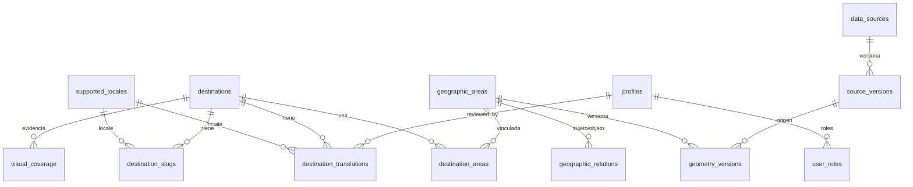

# Modelo de datos

PostgreSQL 16 + PostGIS 3.4 (ADR-0006). Migraciones SQL en `db/migrations/` (versionadas, con checksum). Las tablas se crean **por fase**; este documento distingue lo que **ya existe** (`IMPLEMENTADO`) de lo **planificado**.

## Esquemas y portabilidad

| Esquema      | Contenido                                                                                                              |
| ------------ | ---------------------------------------------------------------------------------------------------------------------- |
| `public`     | Tablas de la aplicación (todas con RLS). Es el esquema que expone la API de Supabase                                   |
| `app`        | Funciones auxiliares (`current_user_id`, `has_role`, `is_editor`…), _triggers_ y `schema_migrations`. **No** se expone |
| `extensions` | PostGIS, `pg_trgm`, `unaccent` (así `spatial_ref_sys` no cuelga de `public`)                                           |

Las migraciones (`db/migrations/0001…0005`) son SQL puro con checksum; la identidad sale de los claims JWT (`request.jwt.claims`), no de `auth.uid()`, de modo que son aplicables a PostgreSQL local y a Supabase. El `search_path` de la API debe incluir `extensions` (Supabase ya lo hace).

## Principios

1. **Identidad separada de contenido**: una entidad tiene un `id` y una geometría; el texto vive en tablas de traducción **tipadas** (no EAV).
2. **Procedencia a nivel de dato**: institución, URL, licencia, fecha de consulta, versión, hash, verificación, vigencia.
3. **El estado de verificación se deriva** de evidencia + caducidad; no hay un booleano `verified`.
4. **Original ≠ visualización**: `geometry_versions` conserva el original; las simplificaciones son derivados descartables.
5. **RLS en todas las tablas**; la autorización de aplicación se hace además en servidor.
6. **Auditoría** de cambios sensibles: quién, qué, cuándo, antes y después.
7. Sin `service-role` en el cliente; funciones `SECURITY DEFINER` con `search_path` fijo.

## Entidades IMPLEMENTADAS (Fase 1)

| Tabla                             | Propósito                                                                                       | Notas clave                                                                   |
| --------------------------------- | ----------------------------------------------------------------------------------------------- | ----------------------------------------------------------------------------- |
| `supported_locales`               | Registro de idiomas con integridad referencial                                                  | 5 filas semilla; las FK de traducciones y slugs apuntan aquí                  |
| `profiles`, `user_roles`          | Usuarios y roles (`editor`, `reviewer`, `admin`, `business_owner`)                              | Los roles **solo** los escribe `admin`; un usuario no puede cambiar los suyos |
| `data_sources`, `source_versions` | Fuentes y versiones con licencia, atribución, hash, fecha de consulta                           | Lectura pública (atribución)                                                  |
| `geographic_areas`                | Entidad geográfica (`kind`, `source_class`: `official` · `osm_derived` · `editorial`)           | `is_public` controla la visibilidad anónima                                   |
| `geometry_versions`               | **Original** versionado (`geometry(Geometry,4326)`), validación, `area_m2` (método `geography`) | Índice GiST; `ST_IsValid` registrado, **no reparado en silencio**             |
| `geographic_relations`            | `administrative` · `contains` · `near` · `access_via` con evidencia                             | Sin autorrelaciones; **no es un árbol**                                       |
| `destinations`                    | Concepto turístico con `key` inmutable, `kind`, `status`, `version`                             | `key` ≠ nombre; `version` sube con cambios editoriales                        |
| `destination_areas`               | Vincula destino ↔ área con **rol** (`primary`/`context`/`access`)                               | Nunca por nombre                                                              |
| `destination_slugs`               | Slugs por idioma con alias                                                                      | `UNIQUE(locale, slug)`; un único `is_current` por destino+idioma              |
| `destination_translations`        | Traducción tipada con estado editorial                                                          | Ver reglas abajo                                                              |
| `visual_coverage`                 | Evidencia de cobertura por destino/capacidad/proveedor                                          | Vista `current_visual_coverage` **deriva** `UNKNOWN` al caducar               |
| `rights_policies`                 | Política de derechos con estado `verified`/`provisional` y acciones permitidas                  | Alimenta el evaluador (ADR-0007)                                              |
| `audit_events`                    | Registro inmutable de cambios                                                                   | Solo se inserta por _trigger_; lectura solo `admin`                           |

### Reglas de traducciones (`destination_translations`)

- `PRIMARY KEY (destination_id, locale)`; FK a `destinations` y a `supported_locales`.
- `translation_status ∈ {draft, machine_translated, reviewed, published, outdated}`.
- `reviewed`/`published` ⇒ `reviewed_by` **y** `reviewed_at` no nulos.
- `machine_translated` ⇒ `reviewed_by` **nulo** (una máquina no puede figurar como revisora).
- _Trigger_: al subir `destinations.version`, las traducciones con `source_version` anterior pasan a `outdated` (no se borran).
- Un **revisor** no puede revisar **su propia** traducción (`translated_by ≠ reviewed_by` cuando ambos existen).

### Cobertura derivada

`current_visual_coverage` devuelve, por fila, `effective_status`: el estado almacenado si `now() < expires_at`; si no, **`UNKNOWN`** (nunca `UNAVAILABLE`). `ERROR` y `UNKNOWN` **no** se convierten en ausencia.

## Matriz RLS (Fase 1)

| Tabla                                    | Visitante (anon)                                       | Usuario                | Editor                                  | Revisor                                           | Admin                  |
| ---------------------------------------- | ------------------------------------------------------ | ---------------------- | --------------------------------------- | ------------------------------------------------- | ---------------------- |
| `destinations`                           | Solo `published`                                       | igual                  | CRUD                                    | lectura                                           | CRUD                   |
| `destination_translations`               | Solo `published` de destinos `published`               | igual                  | Crear/editar **sin** fijar `reviewed_*` | Pasar a `reviewed/published` fijándose a sí mismo | CRUD                   |
| `destination_slugs`                      | De destinos `published`                                | igual                  | CRUD                                    | lectura                                           | CRUD                   |
| `geographic_areas` / `geometry_versions` | `is_public` o vinculadas a destino `published`         | igual                  | CRUD (editorial)                        | lectura                                           | CRUD                   |
| `data_sources` / `source_versions`       | Lectura (atribución)                                   | igual                  | CRUD                                    | lectura                                           | CRUD                   |
| `visual_coverage`                        | Lectura vía vista de cobertura de destinos `published` | igual                  | CRUD                                    | lectura                                           | CRUD                   |
| `rights_policies`                        | **Sin acceso**                                         | sin acceso             | lectura                                 | lectura                                           | CRUD                   |
| `profiles`                               | Sin acceso                                             | **Solo el propio**     | lectura                                 | lectura                                           | CRUD                   |
| `user_roles`                             | Sin acceso                                             | Lectura de los propios | sin acceso                              | sin acceso                                        | **Solo admin escribe** |
| `audit_events`                           | Sin acceso                                             | sin acceso             | sin acceso                              | sin acceso                                        | Lectura                |

Pruebas de integración contra PostgreSQL real verifican cada celda relevante (ver `docs/testing.md`).

### Añadido en la Fase 3.a (migración `0006`)

| Tabla                   | Para qué                                                                                                                                        | Visitante (anon)           | Usuario    | Editor                                               | Admin   |
| ----------------------- | ----------------------------------------------------------------------------------------------------------------------------------------------- | -------------------------- | ---------- | ---------------------------------------------------- | ------- |
| `geographic_area_names` | Nombre **local** de la fuente (sin idioma), nombres por idioma **solo si la fuente los trae**, o editorial; con procedencia y versión de fuente | Solo los de áreas visibles | igual      | Escribe solo `editorial` y solo en áreas `editorial` | CRUD    |
| `import_runs`           | Registro de cada ingesta (conjunto, versión de fuente, hash, estado `applied`/`noop`, recuentos, cuarentena)                                    | **Sin acceso**             | sin acceso | Lectura (personal)                                   | Lectura |

- `geographic_areas.external_ref ->> 'overture_id'` es **único** (`geographic_areas_overture_id_uq`): la identidad de un área de Overture es su ID, nunca el nombre.
- `geographic_area_names`: `source_local` sin idioma y como máximo uno por área; `source_common` con idioma y uno por idioma; las de fuente exigen `source_version_id`; sin caracteres de control.
- Los cambios de ambas tablas quedan en `audit_events`. Nadie con rol de aplicación escribe `import_runs`: solo el propietario que ejecuta la importación.

### Añadido en la Fase 4 (migración `0007`) — modelo de contenido (ADR-0019)

| Tabla / vista                | Para qué                                                                                                                                                           | Visitante (`anon`)                                                                              | Persona autenticada sin rol | Editor                                        | Revisor                                                | Admin                                  |
| ---------------------------- | ------------------------------------------------------------------------------------------------------------------------------------------------------------------ | ----------------------------------------------------------------------------------------------- | --------------------------- | --------------------------------------------- | ------------------------------------------------------ | -------------------------------------- |
| `content_fields`             | Catálogo de campos (tipo, sensibilidad, clases de fuente, nº de fuentes, antigüedad máxima, vigencia máxima, tipos de destino). **Semilla del registro de código** | **Sin acceso**                                                                                  | sin acceso                  | lectura                                       | lectura                                                | lectura (solo una migración lo cambia) |
| `source_records`             | Documento citado: institución, título, enlace `https`, fecha de **consulta**, licencia. **Solo inserción**                                                         | Solo los citados por una afirmación pública; **columnas públicas**                              | sin acceso                  | lectura · inserta                             | lectura                                                | lectura · borra (si nadie la cita)     |
| `field_assertions`           | Una **versión** de un campo de un destino: texto original o cantidad, confianza, vigencia, estado del flujo                                                        | Solo `verified`, no reemplazada, vigente y de destino `published`; **sin identidades ni notas** | sin acceso                  | Redacta borradores y los envía a revisión     | Verifica, devuelve, rechaza, disputa o retira          | borra borradores                       |
| `assertion_evidence`         | Fuentes de una afirmación (`supports`/`contradicts`), lugar en la fuente y cita breve opcional                                                                     | Solo las de afirmaciones públicas                                                               | sin acceso                  | CRUD **mientras la afirmación es borrador**   | lectura                                                | igual que editor                       |
| `assertion_translations`     | Traducciones del texto de **esa versión**; el original vive en la afirmación                                                                                       | Solo `published` **y humanas** de afirmaciones públicas; sin autoría ni revisión                | sin acceso                  | Borradores y automáticas, **nunca** revisadas | Pasa a `reviewed/published` **firmando como sí mismo** | borra                                  |
| `field_public_state` (vista) | Estado `EXPIRED`/`DISPUTED` por destino y campo, **sin contenido**                                                                                                 | Lectura (solo destinos `published`)                                                             | lectura                     | lectura                                       | lectura                                                | lectura                                |

- **Estado derivado, no almacenado.** `VERIFIED`/`EXPIRED`/`DISPUTED`/`UNKNOWN` se calcula en `src/domains/content/state.ts` a partir de las afirmaciones y avisos; no hay una columna ni un booleano `verified` en ninguna tabla.
- **Flujo** `draft → in_review → verified` (y `disputed`, `rejected`, `retracted`). Insertar solo es posible como `draft`. En revisión el contenido y la evidencia están **congelados**. Lo verificado es **inmutable**; disputar, rechazar o retirar exige `status_note`. Un cambio de contenido es una **versión nueva** (`version` la asigna el sistema) que al verificarse **reemplaza** (`superseded_at`, solo del sistema) a la vigente; un índice único admite una sola vigente por destino y campo.
- **Verificar** fija `verified_by` (la persona del JWT) y `verified_at` (hora del servidor): el cliente no los elige. Nadie verifica lo que redactó (`CHECK` y puerta `verifier_is_author`).
- **Puertas de verificación**: el disparador `app.assertion_before_update` llama a `app.assertion_gate_issues(...)` y, si hay códigos, lanza `verification_gates_failed` (SQLSTATE `23514`) con los códigos en `DETAIL`. Es el espejo exacto de `src/domains/content/gates.ts`; una prueba de integración compara ambos (ver `docs/testing.md`).
- **Privilegios por columna**: `anon` no puede ni pedir `created_by`, `verified_by`, `status_note`, `created_at` ni `updated_at` (da `permission denied`). Una persona autenticada que **no** es del personal no lee nada de estas tablas.
- Códigos de error de regla: `assertion_must_start_as_draft`, `assertion_invalid_transition`, `assertion_content_is_frozen`, `assertion_identity_is_immutable`, `assertion_verification_is_immutable`, `assertion_superseded_is_system_managed`, `assertion_not_deletable`, `assertion_value_kind_mismatch`, `evidence_is_frozen`, `evidence_cannot_move`, `translation_in_source_locale`, `translation_edit_resets_review`, `translation_identity_is_immutable`.
- `TRUNCATE` está bloqueado en `field_assertions`, `assertion_evidence` y `source_records`, también para el propietario. Los cambios de las cinco tablas se auditan (`audit_events`); la clave de entidad de `assertion_translations` es `assertion_id:locale` y la de `content_fields`, su `key`.
- La **instantánea publicada** (`data/content/published.json`) y su exportador (`pnpm content:export`) están descritos en ADR-0019; la aplicación lee la instantánea, no estas tablas.

## Entidades PLANIFICADAS (por fase)

| Fase | Tablas                                                                                                                                                   |
| ---- | -------------------------------------------------------------------------------------------------------------------------------------------------------- |
| 2–3  | `layers`, `layer_translations`, `style_versions`, `publications`, `attractions`, `access_points`                                                         |
| 4    | `media_assets`, `media_links`, `story_translations` (`field_assertions` y `source_records` ya existen: migración `0007`)                                 |
| 5    | (cobertura de calle) `visual_coverage` ampliada, `story_*`                                                                                               |
| 6    | `businesses`, `business_locations`, `offerings`, `business_memberships`, `registrations`, `business_translations`, `verification_events`, `review_queue` |
| 7    | `activities`, `activity_translations`, `events`, `seasonal_windows`, `advisories`                                                                        |
| 8    | `trails`, `routes`, `route_segments`, `itineraries`, `itinerary_days`, `itinerary_stops`, `itinerary_legs`, `favorites`                                  |
| 9    | `provider_usage`, `budget_reservations` (+ trazas de evaluación de IA)                                                                                   |

Una empresa será **una** entidad con establecimientos y servicios (no tres registros: hotel, restaurante, operador).

> **Nota (F3.c):** `layers`, `layer_translations` y `style_versions` se resolvieron **en código** (registro declarativo, ADR-0017) y las traducciones viven en `messages/*.json`. Las tablas siguen siendo una opción **DEFERRED** si algún día hace falta editar capas sin desplegar.

## Retención y privacidad

- No se almacenan ubicaciones precisas ni prompts con datos personales sin necesidad y protección.
- Política de retención y borrado: `docs/security.md`.
