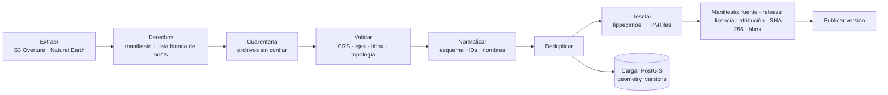

# GIS

Decisiones: ADR-0005 (PMTiles), ADR-0009 (ETL), ADR-0014 (basemap y mapa). Evidencias: E-21…E-26, E-41…E-48.

## 1. Reglas de geometría y coordenadas

| Regla                       | Detalle                                                                                                                                                           |
| --------------------------- | ----------------------------------------------------------------------------------------------------------------------------------------------------------------- |
| Intercambio                 | **EPSG:4326**, GeoJSON en orden **longitud, latitud**.                                                                                                            |
| Medición                    | Distancias en **metros** con `geography` (o una proyección métrica adecuada). **Nunca** en grados ni en Web Mercator (EPSG:3857 distorsiona con la latitud).      |
| Alturas                     | Se distingue **altura elipsoidal** de **elevación sobre el nivel del mar**; el campo lo indica. El terreno AWS es elevación (no elipsoidal).                      |
| Validación de entrada       | CRS declarado, orden de ejes, bbox plausible para Panamá, geometrías vacías, anillos abiertos, autointersecciones, topología.                                     |
| Reparación                  | **`ST_MakeValid` no se usa como reparación silenciosa de datos oficiales.** Se informa y se pone en cuarentena; en derivados se repara **registrando** el cambio. |
| Pertenencia                 | Si un punto sobre el límite **cuenta como dentro**, se usa `ST_Covers` (no `ST_Contains`). Cada consulta declara su semántica.                                    |
| Superficie                  | Calculada con **método identificado** (`ST_Area(geography)` sobre el original), nunca desde la geometría simplificada de visualización.                           |
| Original vs. simplificación | `geometry_versions` guarda el **original**; la simplificación para mostrar se genera aparte y es descartable.                                                     |

Bbox de trabajo de Panamá (para validar y acotar extracciones): `[-83.2, 6.9, -77.0, 9.8]` (lon/lat) — valor de ingeniería, **no** un límite oficial.

## 2. Tipos de teselas (no son intercambiables)

| Tipo                                        | Uso en el proyecto                                            |
| ------------------------------------------- | ------------------------------------------------------------- |
| Raster tiles                                | No se usan (salvo imagen satelital si se decide un proveedor) |
| **Vector tiles (MVT)**                      | Capas propias en **PMTiles**                                  |
| **Terrain tiles** (`raster-dem`, Terrarium) | Relieve y hillshade en MapLibre                               |
| **3D Tiles**                                | Solo con Cesium/Google 3D (diferido, ADR-0004)                |

## 3. Pipeline (ADR-0009)



- **Idempotente**: misma entrada ⇒ mismo hash. Checkpoints, reintentos limitados, registro de cambios de fuente.
- **Seguridad de importación**: lista blanca de hosts (anti-SSRF), límites de tamaño/descompresión (anti zip bomb), rechazo de rutas con `..`/absolutas, XML sin entidades externas, límite de vértices/área por geometría.
- Formatos admitidos progresivamente: GeoJSON, GeoPackage, CSV, Shapefile, KML/KMZ, WFS, WMS (**solo imágenes**, no geometrías descargables), ArcGIS REST y OGC API.
- **Sin geocodificación masiva** con APIs de pago.

## 4. Estrategia de teselas

- Capas estables → **MVT en PMTiles** con tippecanoe: niveles de zoom y extensión **acotados** al bbox de Panamá, simplificación y _drop_ de elementos densos a zoom bajo, atributos mínimos.
- **Nunca** se envían al navegador GeoJSON nacionales enormes: se usa teselado, _clustering_, LOD y carga por extensión visible.
- Servicio estático con **HTTP Range** y **CORS** (se **verifican con una prueba** automática, no se suponen).
- Capas dinámicas: API espacial (siguiente sección). Martin solo si hace falta.

## 5. API espacial limitada

**IMPLEMENTADA (Fase 3.b, ADR-0016)** — ver §12 para el contrato real. Lo que sigue es el contrato inicial; la diferencia es que **no existe el parámetro `version`** (se usa `ETag` del cuerpo) y que los filtros por clave se limitaron a `layers` (lista cerrada):

| Parámetro | Regla                                                                                                                    |
| --------- | ------------------------------------------------------------------------------------------------------------------------ |
| `bbox`    | `minLon,minLat,maxLon,maxLat`; se rechaza si cae fuera del bbox de trabajo o si su **área** excede el máximo configurado |
| `zoom`    | Entero acotado; controla la simplificación/LOD                                                                           |
| `layers`  | Lista de IDs conocidos, con máximo                                                                                       |
| `filters` | Solo claves de una lista blanca; sin SQL libre                                                                           |
| `version` | Versión del dataset (cacheable, `ETag`)                                                                                  |
| Resultado | Máximo de elementos y de bytes; truncado explícito (`truncated: true`)                                                   |
| Tiempo    | _Timeout_ de sentencia en la BD                                                                                          |
| Permisos  | Solo capas **publicadas** para visitantes                                                                                |

## 6. Capas y leyendas

**IMPLEMENTADO (Fase 3.c, ADR-0017; ver §13).** Una capa se declara en un registro en código (`src/domains/geography/layers.ts`) y de él salen el estilo y la leyenda; usa tokens semánticos de color **más** patrón/símbolo/texto. Las tablas `layers`, `layer_translations` y `style_versions` de `docs/architecture.md` §K–L **no se han creado** (DEFERRED: no hay edición de capas en caliente).

## 7. Selección de un área: qué se muestra

Información, **fuente de la geometría** (`official` / `osm_derived` / `editorial`), superficie con método identificado, actividades, restricciones **verificadas**, accesos y fotos. Las áreas dibujadas por administradores **sin** fuente oficial se identifican como **editoriales**; nunca como límites oficiales.

## 8. Pruebas GIS (estado al cierre de la Fase 3)

| Prueba prevista                                | Estado                                                                                                                                                                    |
| ---------------------------------------------- | ------------------------------------------------------------------------------------------------------------------------------------------------------------------------- |
| CRS y orden de ejes                            | **VERIFIED**: `CHECK geometry_in_working_area`, código `geometry.axis_order_swapped`, «defensa en profundidad» (hash recalculado) y la API rechaza lat/lon intercambiados |
| `ST_Covers` en el límite                       | **VERIFIED** (integración con PostGIS real: el borde y el vértice cuentan como dentro)                                                                                    |
| Área con `geography`                           | **VERIFIED** (30 km² medidos frente al valor en grados; el método viaja con el número)                                                                                    |
| Rechazo de bbox enorme                         | **VERIFIED** (unitaria con fuzz, API y E2E)                                                                                                                               |
| Geometría inválida va a cuarentena             | **VERIFIED** (pipeline: 2 casos reales, E-49; BD: el «lazo» se marca `invalid` y no se sirve)                                                                             |
| El original no se altera al simplificar        | **VERIFIED** (la superficie almacenada es idéntica a cualquier zoom; la simplificación es válida y queda dentro de la tolerancia)                                         |
| Distancia geodésica frente a un valor conocido | **DEFERRED**: no hay funciones de distancia hasta las fases de rutas y recomendaciones                                                                                    |
| Ninguna ruta hacia centroides inaccesibles     | **DEFERRED**: no hay _routing_ hasta la Fase 8                                                                                                                            |

El detalle de qué cubre cada nivel está en `docs/testing.md`.

## 9. Basemap de Panamá (Fase 2 — IMPLEMENTADO y VERIFICADO)

Un solo PMTiles `panama-basemap.pmtiles` (z4–14, 36,1 MB) construido por `pipelines/basemap/build_basemap.py` (`pnpm data:build`) **solo desde Overture `2026-09-23.1`** (E-42: tierra y mar completos; Natural Earth no se usa). Es cartografía de referencia **derivada de OpenStreetMap, no oficial**.

| Capa (`source-layer`) | Origen y regla                                                    | Entidades | Zoom |
| --------------------- | ----------------------------------------------------------------- | --------: | ---: |
| `land`                | `base/land` `subtype=land` (continente, islas, islotes)           |     2 851 |   4+ |
| `landcover`           | `forest`/`wetland`/`sand`/`reef`, área ≥ 0,5 km²                  |     1 407 |   8+ |
| `landcover_detail`    | ídem, área < 0,5 km²                                              |     5 376 |  12+ |
| `protected`           | `base/land_use` `subtype=protected` (OSM, no oficial)             |       138 |   4+ |
| `boundaries`          | contorno de `country`/`region`/`county` de Panamá, clase `land`   |        99 |   4+ |
| `ocean`               | `base/water` `subtype=ocean`                                      |        49 |   4+ |
| `water`               | polígonos de agua (lago, embalse, río, canal…), área ≥ 0,5 km²    |       169 |   5+ |
| `water_detail`        | ídem, área < 0,5 km²                                              |     3 145 |  10+ |
| `waterway`            | canal y río con nombre                                            |     2 990 |   7+ |
| `waterway_detail`     | río sin nombre y arroyo                                           |    19 579 |  10+ |
| `places`              | `divisions/division` `locality`/`region` de Panamá (3 085 puntos) |     3 085 |   4+ |

Reglas que importan (con evidencia):

- **Recorte antes de teselar**: un polígono oceánico sin recortar generaría millones de teselas. Las fronteras se calculan **antes** de recortar (si no, el borde del área aparecería como una frontera falsa).
- **Sin `tippecanoe:minzoom` por entidad ni `--drop-*-as-needed`** (E-44). El zoom se fija por capa y por bandas; los puntos se conservan todos (`-r1`).
- **Puerta de verificación** (si falla, no se publica): teselas z7 completas, ancla ↔ lugar dibujado (≤ 25 m), conservación exacta a z14 de todas las capas (se re-tesela con un `fid` para contar) y de los lugares en todos los zooms. Los polígonos < 1 m² se descartan de forma explícita (E-45).
- **Manifiesto** (`public/data/panama-basemap.manifest.json`): release, licencia (**provisional**), atribución, bbox, zooms, reglas y recuentos por capa, versión y argumentos de tippecanoe, `sha256`, resultados de verificación. No lleva marcas de tiempo (determinista).
- **Anclas** (`pnpm data:anchors`): cada destino se fija por **ID de Overture** elegido a mano en `pipelines/anchors/anchors.config.json`; el script comprueba nombre/subtipo/región y la **contención** de la corroboración, y usa el punto `division` enlazado (`division_id`) como marcador. El polígono solo **encuadra**. Ningún límite de destino se dibuja (E-41).

**Estilo** (`src/domains/geography/map-style.ts`, función pura): colores desde tokens `--color-map-*` (claro/oscuro, contraste WCAG probado: costa, fronteras y áreas protegidas ≥ 3:1, etiquetas ≥ 4,5:1). Orden de capas: tierra → cobertura → **relieve** → fronteras → **océano** → agua → áreas protegidas → etiquetas. Fronteras y áreas protegidas se distinguen por **trazo** (continuo/guiones/puntos), no solo por color. La **leyenda** se deriva de las mismas reglas (`buildLegend`).

**Relieve** (opcional, **desactivado por defecto**): `raster-dem` Terrarium de AWS pedido por el navegador; `hillshade` y «Relieve en 3D» (`terrain`, exageración 1,4). El océano se dibuja sobre el relieve para no sombrear batimetría ruidosa (E-25).

**Etiquetas**: glifos SDF de Noto Sans (rangos 0–255, 256–511, 8192–8447, OFL, en `public/map-assets/glyphs/`). Nombre local; `name_<idioma>` solo si la fuente lo trae (E-43).

**Estado en la URL**: `d` (clave estable de destino), `c` (`lon,lat,altitudM,rumbo,cabeceo,alabeo`; la altitud es sobre el suelo del centro y se convierte con el FOV y el tamaño de teselas de MapLibre), `l` (capas). Todo se valida; lo inválido se descarta y se avisa.

## 10. Pruebas GIS implementadas (Fase 2)

Conversión cámara↔zoom contra valores analíticos independientes (zoom 0 ⇒ 1,5 × circunferencia) e ida y vuelta; prueba de **propiedad** de que `formatCamera` siempre produce algo reanalizable y canónico (2 000 cámaras); validación del estilo con `@maplibre/maplibre-gl-style-spec` (+ control positivo); contrato Python↔TypeScript (capas y área de trabajo); anclas dentro del área, de su encuadre y cerca de referencias independientes (guarda de homonimias); agrupamiento sin solapes (300 ensayos); E2E con WebGL real. Detalle en `docs/testing.md`.

## 11. Ingesta controlada de áreas a PostGIS (Fase 3.a — IMPLEMENTADA y VERIFICADA)

Decisiones y alternativas: ADR-0015. Evidencias: E-49, E-50.

```text
Overture (S3, lista blanca, sin redirecciones)
  → pipelines/ingest/import_areas.py    derechos ANTES de extraer; normaliza; valida; cuarentena
  → data/build/ingest/<dataset>/<release>/{raw,valid}.geojsonl, quarantine.jsonl, manifest.json   (fuera de git)
  → scripts/db/import-areas.ts          revalida manifiesto y hash; UNA transacción; PostGIS vuelve a validar
  → geographic_areas · geometry_versions · geographic_area_names · import_runs · destination_areas (rol context)
```

```bash
pnpm data:ingest                                                    # genera los artefactos (Python + red a Overture)
pnpm db:import-areas --manifest data/build/ingest/overture-protected-areas/2026-09-23.1/manifest.json
#   --publish  hace visibles las áreas (decisión editorial; por defecto NO)
#   --target-env development|staging|production  (producción exige que la política de derechos lo permita)
#   una base que no sea local exige IMPORT_CONFIRM_REMOTE=<host>
```

**Reglas de validación** (`pipelines/ingest/validate.py`, versión 1; un incumplimiento manda la entidad a cuarentena con su código): tipo `Polygon`/`MultiPolygon` · coordenadas finitas y en rango · **orden lon/lat** (`geometry.axis_order_swapped`) · anillos cerrados y con ≥ 4 posiciones · área no nula · ≤ 250 000 vértices y ≤ 20 000 anillos · **dentro del área de trabajo** (−85…−75 lon, 5…11 lat). La BD repite lo esencial (CHECK de área de trabajo, validez con PostGIS, ejes) por si el fichero se alterase tras generar el manifiesto.

**Resultado observado (2026-10-20, Overture `2026-09-23.1`)**: 137 áreas protegidas válidas y 2 en cuarentena (E-49); 11 entidades poligonales de referencia de destinos. Todas `osm_derived`, **no oficiales**, no públicas. Superficies con `ST_Area(geography)`.

**Qué NO hace** (no darlo por hecho): no importa límites administrativos ni de destinos; no hay límites oficiales (L-03); no actualiza de forma incremental entre _releases_; no repara geometrías; no traduce nombres.

## 12. API espacial (Fase 3.b — IMPLEMENTADA y VERIFICADA)

Decisiones y alternativas: ADR-0016. Código: validación pura en `src/domains/geography/spatial-query.ts`, ensamblado en `spatial-response.ts`, acceso a la BD en `src/server/spatial/`, rutas en `src/app/api/spatial/`.

| Endpoint                      | Parámetros                                                                                  | Devuelve                                                                                        |
| ----------------------------- | ------------------------------------------------------------------------------------------- | ----------------------------------------------------------------------------------------------- |
| `GET /api/spatial/areas`      | `bbox=oeste,sur,este,norte` · `zoom` 0–18 · `layers` (≤ 4) · `limit` ≤ 200 (100) · `locale` | `FeatureCollection` simplificada para mostrar + `sources` + `meta` (truncado, simplificación)   |
| `GET /api/spatial/areas/{id}` | `id` UUID · `zoom` (12) · `locale`                                                          | `Feature` + todos los nombres de la fuente con su procedencia                                   |
| `GET /api/spatial/locate`     | `lon`, `lat` · `layers` · `locale`                                                          | Áreas que **cubren** el punto (`ST_Covers`), sin geometría, de la más pequeña a la mayor (≤ 20) |

- **Capas** (`layers`): `protected_areas` (`protected_area`) y `context_areas` (país, región, condado, localidad, isla, cuerpo de agua, distrito histórico, infraestructura). `editorial_area` no se sirve aquí.
- **Límites duros**: ventana ≤ 25 grados² (recortada a −85…−75 / 5…11; lat/lon intercambiados → 400); parámetros desconocidos, repetidos o de > 256 caracteres → 400; respuesta ≤ 1,5 MB; 3 s de tiempo máximo de sentencia (504).
- **Simplificación para mostrar**: tolerancia = 1 píxel de una tesela de 512 px (`360 / (512 · 2^zoom)` grados), decimales ≈ 1/10 de píxel. **La superficie y la pertenencia no usan la geometría simplificada.**
- **Superficie**: solo se publica si se conoce el método (`ST_Area(geography, EPSG:4326)` sobre el original).
- **Nombres**: el del idioma pedido si la fuente lo trae; si no, el **local** de la fuente; nunca uno traducido ni de otro idioma. Sin nombre → `name: null` (la interfaz lo dice).
- **Pertenencia**: `ST_Covers` sobre la geometría original, plano lon/lat (como GeoJSON y como lo dibuja el mapa): **el borde cuenta como dentro**.
- **Derechos**: servir exige poder mostrar, transformar y redistribuir; con la política `provisional`, **en producción responde 403 `rights_blocked` sin consultar la BD**.
- **Caché**: `ETag` débil + 304; `public, max-age=60, stale-while-revalidate=300` en 200; `no-store` en errores.
- **Códigos**: 200 · 304 · 400 `invalid_parameters` (con `issues[{field,code}]`) · 403 `rights_blocked` · 404 `not_found` (igual para inexistente, no público o inválida) · 503 `database_unavailable` · 504 `query_timeout` · 500 `internal_error`.

**Qué NO hace** (no darlo por hecho): no pagina (trunca de forma explícita lo más pequeño); no limita la **frecuencia** de peticiones (infraestructura, pendiente); no se ha medido la latencia; no se ha probado con un _pooler_ ni con una base remota; no ofrece `version` ni filtros por atributos.

## 13. Layer Engine y Legend Engine (Fase 3.c — IMPLEMENTADO y VERIFICADO)

Decisiones y alternativas: ADR-0017. Código: `layers.ts` (registro y motores), `map-core.ts` (constantes), `map-style.ts` (`buildMapStyle`/`buildLegend`, capas finas sobre el motor), `components/map/{LayerControls,MapLegend}`.

| Capa (`l`)       | Grupo      | Defecto | Prioridad | Geometría | Zoom mín. | Fuente / derechos             | Selección por clic                 |
| ---------------- | ---------- | ------- | --------: | --------- | --------: | ----------------------------- | ---------------------------------- |
| `land` (base)    | base       | —       |        10 | polígono  |         0 | basemap / `overture`          | —                                  |
| `landcover`      | propia     | **sí**  |        20 | polígono  |         8 | basemap / `overture`          | —                                  |
| `hillshade`      | de tercero | no      |        30 | ráster    |         0 | `terrain-dem` / `aws-terrain` | —                                  |
| `terrain3d`      | de tercero | no      |        35 | ráster    |         0 | `terrain-dem` / `aws-terrain` | —                                  |
| `boundaries`     | propia     | **sí**  |        40 | línea     |         0 | basemap / `overture`          | —                                  |
| `water` (base)   | base       | —       |        50 | polígono  |         0 | basemap / `overture`          | —                                  |
| `waterways`      | propia     | **sí**  |        60 | línea     |         7 | basemap / `overture`          | —                                  |
| `protectedAreas` | propia     | **sí**  |        70 | polígono  |         0 | basemap / `overture`          | `protected-fill`, propiedad `ovid` |
| `places`         | propia     | **sí**  |        80 | punto     |         0 | basemap / `overture`          | —                                  |

- **Símbolo compartido**: color de paleta, grosor, opacidad y trazo se declaran una vez; de ahí salen la capa de MapLibre y la muestra de leyenda (misma referencia). Las reglas `custom` declaran `emits`.
- **`l` en la URL** es la lista **completa** de capas seleccionables activas, en el orden del registro; sin `l`, los valores por defecto. Los datos de terceros se filtran si los derechos no los permiten (también si vienen en el enlace).
- **Orden de dibujo** por prioridad; el océano va encima del relieve. **Leyenda**: la capa de más arriba primero, con texto en cada entrada.
- **Versión de la fuente**: se lee del manifiesto del PMTiles (`release`), no se copia al registro.
- **Qué NO hace**: la leyenda **no es sensible al zoom** (muestra lo que cada capa activa dibuja, no lo visible a ese zoom); solo `protectedAreas` declara selección por clic y **la interacción es de la F3.d**; no hay capas desde la API espacial (origen `geojson`); no hay tablas de capas en la BD.

## 14. Selección de áreas en el mapa (Fase 3.d — IMPLEMENTADA y VERIFICADA)

Decisiones y alternativas: ADR-0018. Código: lógica pura en `area-selection.ts` y `area-detail.ts`; resalte en `layers.ts` (`SELECTION_LAYER_IDS`, `selectionFilter`); interfaz en `components/map/{MapStage,AreasInView,SelectedAreaCard,AreaFacts,area-selection-store,use-area-detail}`; ruta `GET /api/spatial/areas/by-overture/{ovid}`.

- **Qué se selecciona**: las **áreas protegidas** (única capa con `picking`: capa `protected-fill`, propiedad de teselas `ovid` = ID de Overture). `a=<ID de Overture>` en la URL (UUID validado; nunca un nombre).
- **Clic** sobre el lienzo → el área de más arriba. **Lista equivalente** («Áreas protegidas en esta vista»): botones con `aria-pressed`, hasta 30 con el total real, ordenadas con las reglas del idioma. Con áreas superpuestas, el clic elige una y las demás se eligen desde la lista.
- **Resalte**: contorno sólido grueso con halo sobre el borde discontinuo; solo cambia el filtro de dos capas.
- **Ficha**: _siempre_ lo que lleva el mapa (nombre local, «derivado de OpenStreetMap; no es un límite oficial») y «no hay datos verificados de actividades, restricciones de acceso ni cómo llegar»; _con BD_: superficie **con su método** (`ST_Area(geography)` sobre el original), versión de la geometría, fuente, versión, fecha, licencia (enlace `https`) y derechos, y el nombre con su procedencia. Estados: cargando · no disponible · bloqueada por derechos · sin ficha publicada (404 uniforme).
- **«Mostrar el área en el mapa»** encuadra a petición; la cámara nunca se mueve sola.
- **Qué NO hace** (no darlo por hecho): no se pueden seleccionar límites administrativos, lugares ni destinos como «área»; no desambigua áreas superpuestas por tamaño; no hay ficha en producción mientras los derechos sean `provisional` (el mapa mismo se bloquea); no hay actividades, accesos, restricciones ni fotos (no existen datos verificados); no se ha probado con lectores de pantalla reales.
