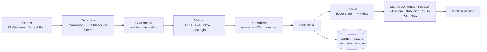

# GIS

Decisiones: ADR-0005 (PMTiles), ADR-0009 (ETL). Evidencias: E-21…E-26.

## 1. Reglas de geometría y coordenadas

| Regla | Detalle |
| --- | --- |
| Intercambio | **EPSG:4326**, GeoJSON en orden **longitud, latitud**. |
| Medición | Distancias en **metros** con `geography` (o una proyección métrica adecuada). **Nunca** en grados ni en Web Mercator (EPSG:3857 distorsiona con la latitud). |
| Alturas | Se distingue **altura elipsoidal** de **elevación sobre el nivel del mar**; el campo lo indica. El terreno AWS es elevación (no elipsoidal). |
| Validación de entrada | CRS declarado, orden de ejes, bbox plausible para Panamá, geometrías vacías, anillos abiertos, autointersecciones, topología. |
| Reparación | **`ST_MakeValid` no se usa como reparación silenciosa de datos oficiales.** Se informa y se pone en cuarentena; en derivados se repara **registrando** el cambio. |
| Pertenencia | Si un punto sobre el límite **cuenta como dentro**, se usa `ST_Covers` (no `ST_Contains`). Cada consulta declara su semántica. |
| Superficie | Calculada con **método identificado** (`ST_Area(geography)` sobre el original), nunca desde la geometría simplificada de visualización. |
| Original vs. simplificación | `geometry_versions` guarda el **original**; la simplificación para mostrar se genera aparte y es descartable. |

Bbox de trabajo de Panamá (para validar y acotar extracciones): `[-83.2, 6.9, -77.0, 9.8]` (lon/lat) — valor de ingeniería, **no** un límite oficial.

## 2. Tipos de teselas (no son intercambiables)

| Tipo | Uso en el proyecto |
| --- | --- |
| Raster tiles | No se usan (salvo imagen satelital si se decide un proveedor) |
| **Vector tiles (MVT)** | Capas propias en **PMTiles** |
| **Terrain tiles** (`raster-dem`, Terrarium) | Relieve y hillshade en MapLibre |
| **3D Tiles** | Solo con Cesium/Google 3D (diferido, ADR-0004) |

## 3. Pipeline (ADR-0009)

- **Idempotente**: misma entrada ⇒ mismo hash. Checkpoints, reintentos limitados, registro de cambios de fuente.
- **Seguridad de importación**: lista blanca de hosts (anti-SSRF), límites de tamaño/descompresión (anti zip bomb), rechazo de rutas con `..`/absolutas, XML sin entidades externas, límite de vértices/área por geometría.
- Formatos admitidos progresivamente: GeoJSON, GeoPackage, CSV, Shapefile, KML/KMZ, WFS, WMS (**solo imágenes**, no geometrías descargables), ArcGIS REST y OGC API.
- **Sin geocodificación masiva** con APIs de pago.

## 4. Estrategia de teselas

- Capas estables → **MVT en PMTiles** con tippecanoe: niveles de zoom y extensión **acotados** al bbox de Panamá, simplificación y *drop* de elementos densos a zoom bajo, atributos mínimos.
- **Nunca** se envían al navegador GeoJSON nacionales enormes: se usa teselado, *clustering*, LOD y carga por extensión visible.
- Servicio estático con **HTTP Range** y **CORS** (se **verifican con una prueba** automática, no se suponen).
- Capas dinámicas: API espacial (siguiente sección). Martin solo si hace falta.

## 5. API espacial limitada

Contrato mínimo (Fase 3), validado con zod, con **límites duros**:

| Parámetro | Regla |
| --- | --- |
| `bbox` | `minLon,minLat,maxLon,maxLat`; se rechaza si cae fuera del bbox de trabajo o si su **área** excede el máximo configurado |
| `zoom` | Entero acotado; controla la simplificación/LOD |
| `layers` | Lista de IDs conocidos, con máximo |
| `filters` | Solo claves de una lista blanca; sin SQL libre |
| `version` | Versión del dataset (cacheable, `ETag`) |
| Resultado | Máximo de elementos y de bytes; truncado explícito (`truncated: true`) |
| Tiempo | *Timeout* de sentencia en la BD |
| Permisos | Solo capas **publicadas** para visitantes |

## 6. Capas y leyendas

Una capa referencia un **dataset** y un **estilo declarativo** (`style_versions`). La **leyenda se genera de las mismas reglas**; usa tokens semánticos de color **más** patrón/símbolo/texto. Ver `docs/architecture.md` §K–L.

## 7. Selección de un área: qué se muestra

Información, **fuente de la geometría** (`official` / `osm_derived` / `editorial`), superficie con método identificado, actividades, restricciones **verificadas**, accesos y fotos. Las áreas dibujadas por administradores **sin** fuente oficial se identifican como **editoriales**; nunca como límites oficiales.

## 8. Pruebas GIS (planificadas)

CRS y orden de ejes; distancia geodésica frente a valor conocido; `ST_Covers` en el límite; área con `geography`; rechazo de bbox enorme; geometría inválida va a cuarentena; el original no se altera al simplificar; ninguna ruta hacia centroides inaccesibles.
