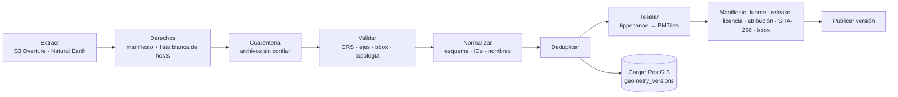

# GIS

Decisiones: ADR-0005 (PMTiles), ADR-0009 (ETL), ADR-0014 (basemap y mapa). Evidencias: E-21…E-26, E-41…E-48.

## 1. Reglas de geometría y coordenadas

| Regla                       | Detalle                                                                                                                                                           |
| --------------------------- | ----------------------------------------------------------------------------------------------------------------------------------------------------------------- |
| Intercambio                 | **EPSG:4326**, GeoJSON en orden **longitud, latitud**.                                                                                                            |
| Medición                    | Distancias en **metros** con `geography` (o una proyección métrica adecuada). **Nunca** en grados ni en Web Mercator (EPSG:3857 distorsiona con la latitud).      |
| Alturas                     | Se distingue **altura elipsoidal** de **elevación sobre el nivel del mar**; el campo lo indica. El terreno AWS es elevación (no elipsoidal).                      |
| Validación de entrada       | CRS declarado, orden de ejes, bbox plausible para Panamá, geometrías vacías, anillos abiertos, autointersecciones, topología.                                     |
| Reparación                  | **`ST_MakeValid` no se usa como reparación silenciosa de datos oficiales.** Se informa y se pone en cuarentena; en derivados se repara **registrando** el cambio. |
| Pertenencia                 | Si un punto sobre el límite **cuenta como dentro**, se usa `ST_Covers` (no `ST_Contains`). Cada consulta declara su semántica.                                    |
| Superficie                  | Calculada con **método identificado** (`ST_Area(geography)` sobre el original), nunca desde la geometría simplificada de visualización.                           |
| Original vs. simplificación | `geometry_versions` guarda el **original**; la simplificación para mostrar se genera aparte y es descartable.                                                     |

Bbox de trabajo de Panamá (para validar y acotar extracciones): `[-83.2, 6.9, -77.0, 9.8]` (lon/lat) — valor de ingeniería, **no** un límite oficial.

## 2. Tipos de teselas (no son intercambiables)

| Tipo                                        | Uso en el proyecto                                            |
| ------------------------------------------- | ------------------------------------------------------------- |
| Raster tiles                                | No se usan (salvo imagen satelital si se decide un proveedor) |
| **Vector tiles (MVT)**                      | Capas propias en **PMTiles**                                  |
| **Terrain tiles** (`raster-dem`, Terrarium) | Relieve y hillshade en MapLibre                               |
| **3D Tiles**                                | Solo con Cesium/Google 3D (diferido, ADR-0004)                |

## 3. Pipeline (ADR-0009)

- **Idempotente**: misma entrada ⇒ mismo hash. Checkpoints, reintentos limitados, registro de cambios de fuente.
- **Seguridad de importación**: lista blanca de hosts (anti-SSRF), límites de tamaño/descompresión (anti zip bomb), rechazo de rutas con `..`/absolutas, XML sin entidades externas, límite de vértices/área por geometría.
- Formatos admitidos progresivamente: GeoJSON, GeoPackage, CSV, Shapefile, KML/KMZ, WFS, WMS (**solo imágenes**, no geometrías descargables), ArcGIS REST y OGC API.
- **Sin geocodificación masiva** con APIs de pago.

## 4. Estrategia de teselas

- Capas estables → **MVT en PMTiles** con tippecanoe: niveles de zoom y extensión **acotados** al bbox de Panamá, simplificación y _drop_ de elementos densos a zoom bajo, atributos mínimos.
- **Nunca** se envían al navegador GeoJSON nacionales enormes: se usa teselado, _clustering_, LOD y carga por extensión visible.
- Servicio estático con **HTTP Range** y **CORS** (se **verifican con una prueba** automática, no se suponen).
- Capas dinámicas: API espacial (siguiente sección). Martin solo si hace falta.

## 5. API espacial limitada

Contrato mínimo (Fase 3), validado con zod, con **límites duros**:

| Parámetro | Regla                                                                                                                    |
| --------- | ------------------------------------------------------------------------------------------------------------------------ |
| `bbox`    | `minLon,minLat,maxLon,maxLat`; se rechaza si cae fuera del bbox de trabajo o si su **área** excede el máximo configurado |
| `zoom`    | Entero acotado; controla la simplificación/LOD                                                                           |
| `layers`  | Lista de IDs conocidos, con máximo                                                                                       |
| `filters` | Solo claves de una lista blanca; sin SQL libre                                                                           |
| `version` | Versión del dataset (cacheable, `ETag`)                                                                                  |
| Resultado | Máximo de elementos y de bytes; truncado explícito (`truncated: true`)                                                   |
| Tiempo    | _Timeout_ de sentencia en la BD                                                                                          |
| Permisos  | Solo capas **publicadas** para visitantes                                                                                |

## 6. Capas y leyendas

Una capa referencia un **dataset** y un **estilo declarativo** (`style_versions`). La **leyenda se genera de las mismas reglas**; usa tokens semánticos de color **más** patrón/símbolo/texto. Ver `docs/architecture.md` §K–L.

## 7. Selección de un área: qué se muestra

Información, **fuente de la geometría** (`official` / `osm_derived` / `editorial`), superficie con método identificado, actividades, restricciones **verificadas**, accesos y fotos. Las áreas dibujadas por administradores **sin** fuente oficial se identifican como **editoriales**; nunca como límites oficiales.

## 8. Pruebas GIS (planificadas)

CRS y orden de ejes; distancia geodésica frente a valor conocido; `ST_Covers` en el límite; área con `geography`; rechazo de bbox enorme; geometría inválida va a cuarentena; el original no se altera al simplificar; ninguna ruta hacia centroides inaccesibles.

## 9. Basemap de Panamá (Fase 2 — IMPLEMENTADO y VERIFICADO)

Un solo PMTiles `panama-basemap.pmtiles` (z4–14, 36,1 MB) construido por `pipelines/basemap/build_basemap.py` (`pnpm data:build`) **solo desde Overture `2026-09-23.1`** (E-42: tierra y mar completos; Natural Earth no se usa). Es cartografía de referencia **derivada de OpenStreetMap, no oficial**.

| Capa (`source-layer`) | Origen y regla                                                    | Entidades | Zoom |
| --------------------- | ----------------------------------------------------------------- | --------: | ---: |
| `land`                | `base/land` `subtype=land` (continente, islas, islotes)           |     2 851 |   4+ |
| `landcover`           | `forest`/`wetland`/`sand`/`reef`, área ≥ 0,5 km²                  |     1 407 |   8+ |
| `landcover_detail`    | ídem, área < 0,5 km²                                              |     5 376 |  12+ |
| `protected`           | `base/land_use` `subtype=protected` (OSM, no oficial)             |       138 |   4+ |
| `boundaries`          | contorno de `country`/`region`/`county` de Panamá, clase `land`   |        99 |   4+ |
| `ocean`               | `base/water` `subtype=ocean`                                      |        49 |   4+ |
| `water`               | polígonos de agua (lago, embalse, río, canal…), área ≥ 0,5 km²    |       169 |   5+ |
| `water_detail`        | ídem, área < 0,5 km²                                              |     3 145 |  10+ |
| `waterway`            | canal y río con nombre                                            |     2 990 |   7+ |
| `waterway_detail`     | río sin nombre y arroyo                                           |    19 579 |  10+ |
| `places`              | `divisions/division` `locality`/`region` de Panamá (3 085 puntos) |     3 085 |   4+ |

Reglas que importan (con evidencia):

- **Recorte antes de teselar**: un polígono oceánico sin recortar generaría millones de teselas. Las fronteras se calculan **antes** de recortar (si no, el borde del área aparecería como una frontera falsa).
- **Sin `tippecanoe:minzoom` por entidad ni `--drop-*-as-needed`** (E-44). El zoom se fija por capa y por bandas; los puntos se conservan todos (`-r1`).
- **Puerta de verificación** (si falla, no se publica): teselas z7 completas, ancla ↔ lugar dibujado (≤ 25 m), conservación exacta a z14 de todas las capas (se re-tesela con un `fid` para contar) y de los lugares en todos los zooms. Los polígonos < 1 m² se descartan de forma explícita (E-45).
- **Manifiesto** (`public/data/panama-basemap.manifest.json`): release, licencia (**provisional**), atribución, bbox, zooms, reglas y recuentos por capa, versión y argumentos de tippecanoe, `sha256`, resultados de verificación. No lleva marcas de tiempo (determinista).
- **Anclas** (`pnpm data:anchors`): cada destino se fija por **ID de Overture** elegido a mano en `pipelines/anchors/anchors.config.json`; el script comprueba nombre/subtipo/región y la **contención** de la corroboración, y usa el punto `division` enlazado (`division_id`) como marcador. El polígono solo **encuadra**. Ningún límite de destino se dibuja (E-41).

**Estilo** (`src/domains/geography/map-style.ts`, función pura): colores desde tokens `--color-map-*` (claro/oscuro, contraste WCAG probado: costa, fronteras y áreas protegidas ≥ 3:1, etiquetas ≥ 4,5:1). Orden de capas: tierra → cobertura → **relieve** → fronteras → **océano** → agua → áreas protegidas → etiquetas. Fronteras y áreas protegidas se distinguen por **trazo** (continuo/guiones/puntos), no solo por color. La **leyenda** se deriva de las mismas reglas (`buildLegend`).

**Relieve** (opcional, **desactivado por defecto**): `raster-dem` Terrarium de AWS pedido por el navegador; `hillshade` y «Relieve en 3D» (`terrain`, exageración 1,4). El océano se dibuja sobre el relieve para no sombrear batimetría ruidosa (E-25).

**Etiquetas**: glifos SDF de Noto Sans (rangos 0–255, 256–511, 8192–8447, OFL, en `public/map-assets/glyphs/`). Nombre local; `name_<idioma>` solo si la fuente lo trae (E-43).

**Estado en la URL**: `d` (clave estable de destino), `c` (`lon,lat,altitudM,rumbo,cabeceo,alabeo`; la altitud es sobre el suelo del centro y se convierte con el FOV y el tamaño de teselas de MapLibre), `l` (capas). Todo se valida; lo inválido se descarta y se avisa.

## 10. Pruebas GIS implementadas (Fase 2)

Conversión cámara↔zoom contra valores analíticos independientes (zoom 0 ⇒ 1,5 × circunferencia) e ida y vuelta; prueba de **propiedad** de que `formatCamera` siempre produce algo reanalizable y canónico (2 000 cámaras); validación del estilo con `@maplibre/maplibre-gl-style-spec` (+ control positivo); contrato Python↔TypeScript (capas y área de trabajo); anclas dentro del área, de su encuadre y cerca de referencias independientes (guarda de homonimias); agrupamiento sin solapes (300 ensayos); E2E con WebGL real. Detalle en `docs/testing.md`.
